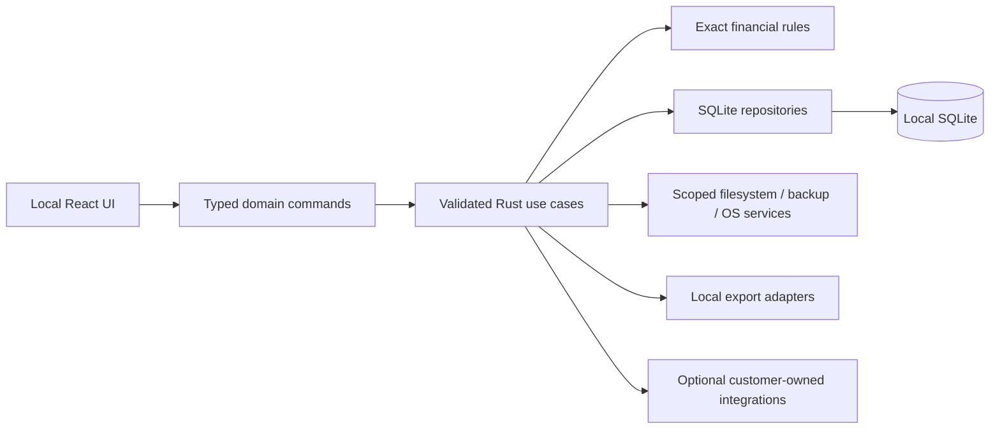

# TWX Payroll — local desktop architecture proposal

Status: Desktop Phase 1 authorized September 29, 2026. Foundation implementation is under review; native compiler/build checks and runtime smoke tests have passed; see docs/DESKTOP_NATIVE_ACCEPTANCE.md. Later phases remain gated.

## System and application boundaries

Use an installable Tauri 2 application with React, strict TypeScript, Tailwind CSS, and embedded SQLite on Windows. Bundle frontend assets locally. Bookkeeping needs no internet, hosted backend, domain, subscription, or developer account. Windows account access is the initial security boundary. The customer owns the installer, database, backups, recovery documentation, and any future provider accounts.

Propose Vite for the React development/build tool and rusqlite with bundled SQLite for Rust database access, subject to supported-version review at implementation. Rust owns SQLite connections, migrations, transactions, exact financial rules, and privileged OS/file operations. Do not expose a generic frontend SQL plugin.

TypeScript validates for user feedback; Rust repeats authoritative validation on every command. Use cases orchestrate transactions, repositories hold parameterized queries, and filesystem services accept narrow operations/scoped destination handles. React contains presentation, transient form state, and navigation, never authoritative financial rules. Long operations use bounded background work/progress rather than blocking the window.

Proposed structure: src/app, src/features, src/components, src/contracts, src/validation; src-tauri/src/{commands,application,domain,repositories,storage,backups,reports,integrations}; src-tauri/migrations; src-tauri/capabilities; tests; docs/recovery. IPC DTOs use strings for financial values. Components can later use another host adapter, but the local database does not synchronize to other PCs/phones/tablets.

## Removed cloud architecture

Remove Next.js rendering/server actions/proxy, Supabase/PostgreSQL, cloud Auth/RLS, service-role secrets, Vercel, hosted functions, domains, organizations/memberships/profiles, tenant foreign keys, and cloud actor identities from the current design. Keep normalized business references, adjustments as rows, exact values, migrations, finalized snapshots, and adapter boundaries. No application login/PIN is required initially. Future PIN/auth/encryption needs its own threat model and key-recovery policy.

## Exact financial representation

SQLite REAL is approximate; declaring DECIMAL/NUMERIC does not recreate PostgreSQL exact arithmetic. [SQLite numeric storage guidance](https://www.sqlite.org/floatingpoint.html).

| Value | SQLite representation | Boundary and computation |
|---|---|---|
| Money | INTEGER minor units; header currency_code and money_scale | IPC integer strings, e.g. amount_minor = "12345" means 123.45 only when approved scale is 2 |
| Rates/weights/tons/mileage/percentage inputs | Canonical decimal TEXT and explicit units | Rust exact decimal parsing; IPC decimal strings |
| Intermediates | No persisted REAL | Checked wide/arbitrary-precision coefficient/scale arithmetic; exact rational division until approved rounding |
| Finalized snapshot | Validated JSON encoded in SQLite TEXT | Money as integer strings with currency/scale; quantities/rates as decimal strings |

Currency/minor-unit scale and permitted money input precision remain unresolved. No financial fields exist in Phase 1. If INTEGER minor units are approved later, persisted money must fit signed i64. Rust checks input and aggregate bounds before writing, including negative extremes; do not rely on SQLite multiplication/aggregation that can overflow or promote numeric types.

Rates, tonnage, mileage, percentages and all other business quantity precision remain unresolved. No significant-digit capacity, fractional scale, bounds or storage precision is selected in Phase 1. Canonical decimal TEXT remains a representation proposal only. Rust enforces syntax, units, bounds, and precision; no exponent notation/nonfinite numbers or silent rounding. Decimal TEXT is not sorted/compared numerically with SQL lexical order. Rust exact logic performs fractional comparisons/calculations; money INTEGER supports ordering.

Never serialize i64 money as a JSON number or use Number/parseFloat for operands. UI works with strings/exact integer helpers; Number remains acceptable for layout. SQLite SUM/TOTAL/CAST-to-REAL is not authoritative financial computation. Select the Rust arithmetic library after verifying range and explicit rounding behavior; no financial library/rules are installed now. PRODUCT_SPEC.md must define input/intermediate/output precision, units, formula, rounding mode, every rounding point, and rule version per calculation. Pending totals stay NULL. Manual final totals need a separately approved policy.

## Storage, connection, and migrations

Resolve app.path().app_local_data_dir() with stable Tauri application identifier com.twx.payroll. This identifier is now fixed for the foundation; changing it requires an explicit data-path migration. Live path: <app-local-data>/data/twx-payroll.sqlite3, expected under the Windows user's LocalAppData. Do not hardcode a username. Show the resolved path read-only with recovery help. Keep WAL/SHM, logs, and private temporary files within app-owned directories. The live database must not reside in Documents, the installer folder, a network drive, or a provider-synchronized folder.

Use one app instance per data directory and one serialized Rust writer. Enable foreign_keys = ON on every connection, WAL on local disk, synchronous = FULL, and a bounded busy timeout. Disable extension loading; evaluate trusted_schema = OFF/defensive settings against the chosen SQLite build. Test disk-full/crash/file-lock behavior. Do not elevate ordinary bookkeeping. WAL has same-host constraints and is not a shared-drive sync solution. [SQLite WAL guidance](https://www.sqlite.org/wal.html).

Use rusqlite_migration 2.6.0 with ordered immutable SQL files embedded in Rust. The library owns PRAGMA user_version and transactional migration execution; no schema_migrations table or manual metadata/checksum registry is maintained. Reject schemas outside the embedded migration set before journal changes or migration writes. Applied migration files must not be edited; add a new ordered migration instead. Version-controlled source and Cargo.lock reproduce migrations; this framework does not detect altered applied migration text at runtime. Phase 1 creates only app_settings. Later upgrades take verified pre-migration backups after backup support exists. Preserve the data path/identifier across upgrades and keep data on uninstall by default.

## Revised SQLite table proposal

Twelve domain/audit tables plus two operational tables are proposed for later phases. Migration versioning uses SQLite user_version, not a table. Only app_settings exists in Phase 1.

Use STRICT tables with supported INTEGER/TEXT types; DATE/BOOLEAN/NUMERIC/JSON are not declared SQLite STRICT types. [SQLite STRICT documentation](https://www.sqlite.org/stricttables.html). This dictionary is a proposal, not executable DDL.

### Common columns and constraints

Domain tables have id TEXT PRIMARY KEY NOT NULL (Rust-generated UUID). Business codes/numbers remain distinct TEXT preserving leading zeros. Mutable domain tables carry created_at/updated_at TEXT UTC RFC3339, created_by/updated_by TEXT trusted local actor labels, row_version INTEGER DEFAULT 1 CHECK > 0. No actor/profile FK. Resolve OS SID/display label/session in Rust; local audit is not tamper-proof against administrators or malware.

Unless marked NULL, columns are NOT NULL. is_active INTEGER DEFAULT 1 CHECK IN (0,1). Required names/codes are nonblank. FKs use ON DELETE RESTRICT; archive catalogs. Business dates are TEXT YYYY-MM-DD with format CHECKs and Rust real-calendar validation. CHECK period_start <= period_end; no assumed weekday or duration. Store 2026-02-28 and 2026-03-06 separately, displaying 02/28/2026 – 03/06/2026 only in UI. Header currency_code TEXT and money_scale INTEGER determine every child amount's encoding. *_minor are INTEGER, *_decimal are canonical TEXT; NULL is unknown.

### Domain and audit tables

| Table | Principal columns beyond common conventions | Relationships / checks |
|---|---|---|
| drivers | driver_code TEXT UNIQUE, name TEXT, is_active INTEGER | Independent driver catalog |
| owners | owner_code TEXT UNIQUE, name TEXT, is_active INTEGER | Independent person/business owner catalog; no generic payee hierarchy |
| trucks | truck_number TEXT UNIQUE, is_active INTEGER | No fixed owner/driver assignment |
| twx_codes | code TEXT UNIQUE, label TEXT NULL, is_active INTEGER | Shared reference proposal; meaning/requiredness pending |
| plants | plant_code TEXT NULL, name TEXT, address TEXT NULL, is_active INTEGER | Optional lookup; names need not be unique |
| jobs | job_code TEXT NULL, name TEXT, plant_id TEXT NULL FK plants.id, is_active INTEGER | Optional plant association; code uniqueness pending |
| adjustment_types | code TEXT UNIQUE, label TEXT, is_active INTEGER | Seed %, Insurance, Hopper, Reimbursement, Apportioned Plates; no automatic signs/formulas |
| payroll_entries | entry_kind TEXT, driver_id TEXT NULL FK drivers.id, owner_id TEXT NULL FK owners.id, truck_id TEXT FK trucks.id, twx_code_id TEXT NULL FK twx_codes.id, week_ending TEXT, currency_code TEXT, money_scale INTEGER, amount_minor INTEGER, ach_charge_minor INTEGER NULL, notes TEXT NULL, status TEXT DEFAULT 'draft', finalized_at/by TEXT NULL, finalized_amount_minor INTEGER NULL, finalized_snapshot_json TEXT NULL, calculation_rule_version TEXT NULL, supersedes_id TEXT NULL FK payroll_entries.id, correction_reason TEXT NULL | Driver XOR owner consistent with entry_kind; status draft/finalized; no payee/truck/week uniqueness assumed |
| weekly_settlements | settlement_number TEXT UNIQUE, driver_id TEXT FK drivers.id, truck_id TEXT FK trucks.id, owner_id TEXT NULL FK owners.id, period_start/end TEXT, currency_code TEXT, money_scale INTEGER, notes TEXT NULL, status TEXT DEFAULT 'draft', calculation_mode TEXT DEFAULT 'pending', manual_total_minor/calculated_total_minor INTEGER NULL, finalized_total_minor INTEGER NULL, finalized_at/by TEXT NULL, finalized_snapshot_json TEXT NULL, calculation_rule_version TEXT NULL, supersedes_id TEXT NULL FK weekly_settlements.id, correction_reason TEXT NULL | Inclusive saved period; mode pending/manual/approved_rule; driver/truck required proposal pending Q5 |
| loads | settlement_id TEXT FK weekly_settlements.id, display_order INTEGER, load_number TEXT, bol_number/po_number TEXT NULL, plant_id/job_id TEXT NULL FK plants/jobs, plant_name/job_name TEXT NULL, truck_id TEXT FK trucks.id, driver_id TEXT FK drivers.id, completed_on TEXT NULL, net_weight_decimal/tons_decimal/mileage_decimal/rate_decimal TEXT NULL, weight_unit/ton_unit/mileage_unit/rate_unit TEXT NULL, total_minor INTEGER NULL, total_source TEXT DEFAULT 'manual', source_system TEXT DEFAULT 'manual', external_id TEXT NULL, provenance_json TEXT NULL | One settlement revision per row; actual rate terminology pending; row/header driver/truck equality not assumed |
| settlement_adjustments | settlement_id TEXT FK weekly_settlements.id, display_order INTEGER, twx_code_id TEXT NULL FK twx_codes.id, adjustment_type_id TEXT NULL FK adjustment_types.id, explanation TEXT, amount_minor INTEGER NULL, input_mode TEXT DEFAULT 'manual', percentage_decimal TEXT NULL, percentage_base_decimal TEXT NULL, rule_version TEXT NULL | Flexible rows; dormant percentage inputs until approved; money inherits header scale |
| audit_events | id TEXT PK, occurred_at TEXT, actor_label TEXT, actor_kind TEXT, session_id TEXT NULL, entity_type TEXT, entity_id TEXT, operation TEXT, before_json/after_json TEXT NULL, reason TEXT NULL, correlation_id TEXT NULL | Append-only; no common updated/version fields; no polymorphic entity FK so deleted-draft history survives |

Slash shorthand expands to separate columns with listed type/nullability; finalized_at/by is finalized_at timestamp TEXT and finalized_by actor TEXT. Money scale constraints remain unresolved; currency format is three uppercase letters, with approved combinations checked in Rust. actor_kind CHECK local_user/system/integration; operation CHECK create/update/delete/archive/finalize/correction. Finalized JSON includes a snapshot schema version and json_valid CHECK. Mode/source/status fields have enumerated CHECKs; provenance never contains credentials.

### Operational tables

| Table | Columns / constraints | Planned phase |
|---|---|---|
| app_settings | key TEXT PK CHECK theme only, value TEXT CHECK system/light/dark, updated_at TEXT UTC timestamp; STRICT | Phase 1 appearance only; future preferences require a reviewed migration |
| backup_runs | id TEXT PK, kind TEXT CHECK manual/automatic/pre_migration/pre_restore, started_at TEXT, completed_at TEXT NULL, status TEXT CHECK running/succeeded/failed/cancelled, destination TEXT NULL, backup_name TEXT NULL, schema_version INTEGER, app_version TEXT, checksum TEXT NULL, error_summary TEXT NULL | Backup phase; history of local completion, not proof of cloud upload |

### Relationships, indexes, and finalized history

Payroll payee CHECK: (entry_kind = 'driver' AND driver_id IS NOT NULL AND owner_id IS NULL) OR (entry_kind = 'owner' AND owner_id IS NOT NULL AND driver_id IS NULL). Both/neither fail. Draft finalization fields must be NULL; finalized rows require timestamp, actor, snapshot, final amount, and approved rule version. A manual policy also has a version. Child display_order >= 0 with UNIQUE(settlement_id, display_order); reorder in a transaction via temporary positions, since SQLite does not support the earlier deferred uniqueness design.

Index payroll_entries(week_ending, entry_kind, id), weekly_settlements(period_end, status, id), both child tables(settlement_id, display_order), audit_events(entity_type, entity_id, occurred_at), and used FK columns. UNIQUE(supersedes_id) WHERE NOT NULL prevents multiple direct successors. Imported load UNIQUE(settlement_id, source_system, external_id) WHERE external_id IS NOT NULL deduplicates within a revision and permits correction clones; source_system namespaces provider/account before imports. Global shared-load semantics remain pending.

BEGIN IMMEDIATE and a serialized writer replace row-locking/server-function concepts. Rust checks expected versions, computes approved results exactly, and writes aggregate/snapshot/status/audit atomically. Child edits advance the parent version. Triggers reject finalized header/child mutations/deletion, child moves involving finalized parents, and audit updates/deletes. Rust records audit inserts in the same transaction. SQLite has no application-user grants/RLS; boundary enforcement is through narrow commands and OS file access.

Finalized revision snapshots deliberately preserve IDs plus literal TWX code/label, explanation_snapshot, driver/owner names, truck number, plant/job labels, dates, units, every input, currency/scale, results, and rule versions. Snapshots are JSON TEXT inside SQLite, not business JSON files. Normalized columns govern queries/relationships; immutable render payloads preserve old statement evidence without duplicating every label everywhere. Free-text plant/job labels support manual entries without catalogs.

Propose Correct record → linked draft with required reason, new header/child UUIDs, original retained, and a simple History view. Prevent cycles, require finalized predecessor, and assign a distinct settlement number per revision. Replacement/reversal/payment-delta semantics remain pending. History distinguishes effective finalized predecessor from pending correction; no automatic summing across revisions before approved policy. Payroll and settlements stay independent. Effective-dated assignments/payment allocations are deferred, not invented.

## Database location and recovery ownership

The active database remains under app-local data with user-scoped access. Full standalone SQLite snapshots are portable to a compatible installation without any developer credentials. Publish schema/financial encoding/recovery instructions with the release. No encrypted database is assumed; Windows account permissions are not encryption. Optional encryption must have offline key recovery before adoption. Update/uninstall policy must preserve customer data and a stable application identifier.

## Backup and restore strategy

Backups must ship before real business-data entry, but not in foundation Phase 1. Provide manual backup, full database copy/export, destination selection, restore, automatic cadence, retained generations, and visible last successful backup/failure/overdue status.

Use SQLite's Online Backup API through Rust to create a consistent standalone snapshot of the active database. Never raw-copy the live main file or independently copy WAL/SHM; checkpoint alone is insufficient for a safe active-copy workflow. [SQLite backup API](https://www.sqlite.org/backup.html). Stage locally, close/validate with integrity_check, foreign_key_check, supported schema and domain invariants, then publish a unique generation to the chosen folder.

Write a .partial database and manifest (app/schema version, snapshot time, checksum, currency/decimal encoding); flush/close and publish completion marker/rename only after validation. Accept completed/revalidated generations for restore. Ordinary full-database export provides a validated standalone .sqlite3 file. Manifests are metadata, not primary records. Filesystem writes and backup_runs cannot be one atomic transaction: reconcile after crashes, and never record success just because a job started.

Destination is an ordinary user-selected folder, optionally removable or already synced by OneDrive/Drive/Dropbox/etc. No provider is assumed or contacted. Success means a completed local backup, not completed cloud upload. The live database stays outside the sync folder. Proposed defaults for approval: daily while running when data changed, catch up on next launch, backup before migrations/restore; keep seven daily/four weekly successful automatic generations; manual/pre-restore generations remain until deliberate deletion. Closed-app schedules require separately approved OS scheduling, not a promise that an inactive app runs itself.

Retention touches only verified app-generated generations and never removes the last good backup. Changing destination leaves previous backups intact. Destination unavailable/disk-full/cancellation shows a clear failure and retains honest last-success/overdue state; do not silently switch folders. A backup created before its own success event may omit that backup_runs row; validated manifests reconcile history after restore. Synced folders are not automatically encrypted.

Automatic scheduling tracks actual business-data changes separately from backup_runs/settings writes, so recording a backup does not itself cause another backup. The last-success time refers to a validated completed generation. A manifest checksum detects damage, not malicious tampering or independently proves upload completion.

Restore: show generation date/version and explain replacement of newer local changes. Copy/validate candidate in isolated staging; reject corruption/future schema. Create a verified pre-restore rollback generation. Pause writes, finish transactions, hold app restore lock, close all connections, and retire/checkpoint old WAL with its old main generation. Stage candidate on the live volume; perform journaled rename/replace, retaining original files until reopen/schema/integrity/domain checks succeed. Never apply old sidecars to a restored main file. Abort safely on Windows file locks; revert to original on failure.

A small durable restore journal outside SQLite is permitted nonbusiness recovery metadata while the database is closed/replaced. Startup completes or rolls back interrupted swaps before edits. Apply supported older-schema migrations only transactionally, preserving source and rollback. Confirm expected records after restore; reconfirm machine-specific destination preferences and reconcile last-backup status on a new PC. Restore replaces a dataset; it does not merge or sync.

Recovery documentation explains locating data, compatible offline installation, selecting/validating a backup, restoring, checking known records/totals, and exporting. Standard SQLite tooling can inspect a copied standalone file without the developer. Test backup/restore with WAL writes, interruption, locks, disk-full, corrupted files, schema incompatibility, and a fresh PC/user.

## Desktop capabilities and security

Explicit Tauri permissions/capabilities allow only the named local window and necessary commands. No remote pages with IPC, unrestricted filesystem/shell, or generic SQL. Validate command/window arguments in Rust; restrictive CSP and local bundled assets prevent incidental network dependencies. [Tauri capability guidance](https://v2.tauri.app/security/capabilities/).

Native dialogs select destinations; Rust retains canonical scoped approval handles, rejects traversal/reparse-point escapes, and prevents overwriting the live database with reports/backups. UI cannot supply arbitrary unrestricted paths. Render notes as text. Customer-owned API/OAuth secrets stay in Windows Credential Manager or an evaluated secure store, outside React/settings/logs/normal backups. A future PIN protects UI convenience only unless paired with separately designed encryption.

## Local exports and optional adapters

A canonical dataset reads SQLite consistently; finalized reports use frozen revision snapshots. Local renderers create PDF (primary printable format), CSV, XLSX, DOCX. Preserve decimal fidelity, label drafts/revisions, neutralize spreadsheet formula injection, verify pagination/fonts offline, and save only to approved destinations. Scoped print/open uses approved generated PDF/default viewer and reports recoverable failures.

Email later uses a supported native/default-client mechanism, customer-owned email API credentials, or explicit integration. mailto attachments cannot be assumed; provide saved-attachment/manual attach fallback where needed. Google Sheets uses customer-owned OAuth/network access and secure local token storage; callback/consent requirements depend on chosen provider. Neither needs a permanently hosted TWX server.

Routing adapters return provider-neutral candidate fields/units, account/source/external IDs, fetch time, and per-field provenance. Validate/review, preserve manual overrides, and save drafts through the same version/transaction boundary. No provider/offline errors leave manual entry usable. Finalized records are immutable. Import/delivery/token tables are deferred until actual provider requirements exist. Cloud synchronization is a separate future architecture.

## Desktop distribution risks and decisions

Propose per-user Windows installation with stable app ID, bundled assets, and preserved app data. WebView2 is a runtime prerequisite: choose verified installed runtime or an offline installer package; do not require an online bootstrap. [Tauri Windows installer options](https://v2.tauri.app/distribute/windows-installer/). Developer Rust/build tools are not bookkeeper prerequisites.

Review Windows versions/CPU, minimum window/DPI support, installer format/runtime footprint, code signing/SmartScreen, customer-owned signing/release continuity, offline updates, backup encryption/retention/disk capacity, and Excel import requirements. Updates retain records and cannot be mandatory online checks. No updater/service/deployment is implemented by this proposal.

Windows installer signing belongs to the distribution phase. It is not required for Phase 1 development/build validation and does not block application development.
