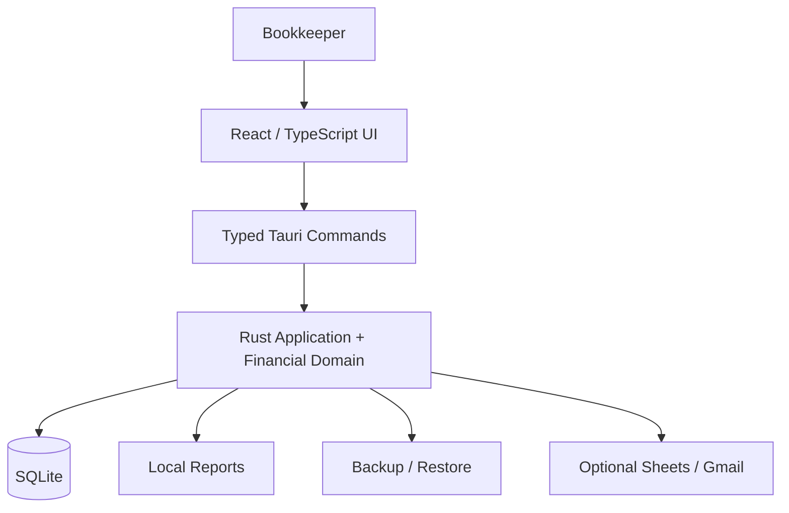

# TWX Payroll

A local-first Windows desktop bookkeeping and payroll application designed to replace an Excel-based trucking workflow.

TWX Payroll brings drivers, driver types and payout percentages, owners, trucks, TWX codes, plants, jobs, loads, adjustments, weekly settlements, driver/owner payroll, historical records, reports and recovery into one local workspace.

## Quick Start for the Bookkeeper

**Install the Windows application. You do not need Node.js, npm, Rust, Cargo, Visual Studio, VS Code, Codex, or the source code.**

### Download TWX Payroll

1. Open the [TWX Payroll Releases](https://github.com/matthewalexander97/TWX-PayRoll/releases/latest) page.
2. Under **Assets**, download the Windows installer: `TWX Payroll_0.2.0_x64-setup.exe`.
3. Optionally download `SHA256SUMS.txt` and verify the installer checksum.
4. Run the installer.
5. The application is currently unsigned, so Windows SmartScreen may display a warning. If the installer came from this official repository and the checksum matches, review the file information and use the normal Windows option to continue.
6. Open **TWX Payroll** from the Start Menu after installation.

Never disable SmartScreen, antivirus, or Windows security policies to install TWX Payroll.

## Windows Requirements

- **Windows x64**; the current target is Windows 11 x64. Other Windows versions and architectures require separate validation.
- **Microsoft Edge WebView2 Runtime**, used to display the desktop interface.

The installer includes the Evergreen offline WebView2 installer and is configured to provision the Runtime when needed. Installation on an independent machine with WebView2 absent remains unverified. No hosted backend or online account is required for local bookkeeping.

## First-Time Setup

1. Open **Settings**.
2. Choose **Light**, **Dark** or **System** appearance if desired.
3. Configure a **backup folder** before relying on the app for real records.
4. Confirm the **export folder**; it defaults to Windows **Documents**.
5. In **Drivers**, create **Driver Types** with your approved payout percentages.
6. Create **Drivers** and select their types.
7. Create **Owners**.
8. Create **Trucks** with their owners and optional default drivers.
9. Add **TWX Codes**, **Plants**, **Jobs** and **Adjustment Types** in **Reference Records** (below Reports) as needed.
10. Start a settlement in **Weekly Settlements / Loads**.

Open the built-in **User Manual** for detailed instructions. It works offline; the same content is available in the [User Guide](USER_GUIDE.md).

## How to Use TWX Payroll

### Weekly Settlement

Select the inclusive period start/end dates, driver and truck. Add load rows with **Tons / Net Weight** and **Completion Rate**, then enter any additions or deductions. Review the payout and **Save Draft** or **Finalize**.

The workflow is:

```text
Load Total = Tons × Completion Rate
Sum load totals → apply driver payout percentage → add/deduct adjustments
→ Final Settlement Payout → linked Driver Payroll Amount
```

Dates are selected explicitly; periods need not be exactly seven days. The driver percentage comes from the configured driver type. The current per-load and percentage rounding rule is provisional pending comparison with historical TWX statements; see the [User Guide](USER_GUIDE.md#driver-percentage).

### TWX Payroll

- A finalized driver settlement automatically supplies the linked **Driver Payroll Amount**.
- **ACH Charge is driver-only**. Driver Payroll **Total = Amount + ACH Charge**.
- **Owner Payroll** amounts are entered manually; owners have no ACH Charge.
- History filters retrieve saved periods. Finalized records can be edited through the application while retaining before/after audit history.

The application records bookkeeping; it does not execute bank payments. Full settlement, adjustment and payroll instructions are in the [User Guide](USER_GUIDE.md).

## Backups and Recovery

**SQLite is the authoritative data store. Excel, PDF, CSV and DOCX exports are not backups.**

In **Settings → Backup & recovery**, select a destination and use **Backup Now**. Wait for a validated **SUCCESS** entry. **Restore Backup** provides guided recovery with a pre-restore safety copy.

The destination may be local, on an external drive, or inside an already-synchronized OneDrive, Google Drive or Dropbox folder. A backup on the same drive does not protect against drive failure; verify external copies or synchronization yourself. Keep each snapshot with its matching manifest. Backups are not encrypted.

Keep the live SQLite database in its application-data directory. Do not move it into a synced folder or copy an active database manually. Configure backups before relying on real records and make a validated backup before upgrading or uninstalling.

Follow [Data Recovery](DATA_RECOVERY.md) for restore, moving to another computer and preserving records after a failure.

## Reports and Exports

Export saved records as **PDF**, **Excel/XLSX**, **CSV** or **Word/DOCX**. **Print / Preview PDF** opens a local PDF for printing through your viewer. Save edits before generating a report.

The default export destination is the current Windows user's resolved **Documents** folder. **Settings → Export Settings** provides **Change Folder**, **Reset to Documents** and **Open Export Folder**. **Save As…** selects a one-off destination without changing the default.

Normal exports add numbered suffixes when a filename already exists. Unavailable destinations produce an error without silent fallback. Exports are readable copies of saved records and cannot restore the database.

## User Manual

The application includes an **offline User Manual** covering setup, settlements, payroll, adjustments, reports, exports, backups and troubleshooting. Open it from the main navigation or read [USER_GUIDE.md](USER_GUIDE.md).

## Optional Integrations

Google Sheets and Gmail outputs require your own Google configuration and account. **Live provider validation remains pending.** These integrations are optional; bookkeeping, local reports and recovery work offline without them.

Sheets creates a separate report snapshot; Gmail sends a generated attachment after your confirmation. See [Integration Setup and Recovery](docs/INTEGRATIONS_GUIDE.md).

## Data Ownership and Privacy

Business/payroll records are stored locally, conceptually under `%LOCALAPPDATA%\com.twx.payroll\`. **Settings → Application & storage** shows the actual database path. Ordinary uninstall is designed to retain the complete application-data workspace and has no payroll-data deletion option; runtime uninstall/reinstall preservation remains pending validation.

Business data stays local unless you deliberately export or send it. You control backup/export destinations, including whether those folders are synchronized by other software. Optional Google credentials are protected separately from the business database. There is no required hosted backend. Use the app's supported editing and recovery controls rather than manually editing SQLite files.

## Technical Overview

**Tauri 2 · React · strict TypeScript · Tailwind CSS · Rust · SQLite · WebView2**

The application combines a responsive light/dark/system interface with Rust-owned validation, financial logic and transactions. Architectural priorities include:

- Exact fixed-point calculations and historical financial snapshots.
- SQLite-safe backups, validated restore and rollback protection.
- Audit history for finalized edits and linked payroll updates.
- Narrowly scoped Tauri commands and permissions.
- One saved report dataset for local formats and optional Google outputs.
- Local operation without a required server or online login.



Money is stored as integer cents; tons, rates and percentages use exact fixed-point representations. Rust performs authoritative arithmetic with checked integer intermediates. JavaScript floating point does not calculate authoritative financial values. Finalized records preserve historical values and labels; supported edits retain audit history.

See [Architecture](ARCHITECTURE.md), [Product Specification](docs/PRODUCT_SPEC.md) and [Implementation Plan](docs/IMPLEMENTATION_PLAN.md) for design decisions and scope.

### Repository Structure

```text
src/                    React UI, typed IPC contracts and frontend tests
src-tauri/              Rust services, desktop configuration and permissions
src-tauri/migrations/   Immutable, ordered SQLite migrations
src-tauri/installer/    Data-preserving NSIS template and provenance
docs/                   Requirements, reviews and operating/build guidance
scripts/                Verification and release/handoff tooling
third-party/            Dependency notices and corresponding source material
legacy/web/             Superseded web scaffold; excluded from desktop builds
```

### Screenshots

Repository screenshots are not included yet. Published examples should use synthetic/demo data only.

## Development

These prerequisites are for maintainers building from source; installed-app users do not need them.

| Prerequisite    | Documented development environment                                                       |
| --------------- | ---------------------------------------------------------------------------------------- |
| Node.js / npm   | Node 24.13.0 / npm 11.6.2; a supported compatible Node 24 release may be used            |
| Rust / Cargo    | 1.98.1, pinned by `rust-toolchain.toml`, with rustfmt/clippy and the Windows MSVC target |
| Native compiler | Microsoft C++ Build Tools with **Desktop development with C++**                          |
| Windows SDK     | A supported SDK installed with the native build tools                                    |
| Desktop runtime | Microsoft Edge WebView2 Runtime                                                          |
| Verification    | Microsoft Edge for browser UI/accessibility tests; PowerShell 7 for the native script    |

Run commands in PowerShell from the repository root:

```powershell
npm ci
npm run tauri -- dev
```

For frontend-only development:

```powershell
npm run dev
```

Open `http://127.0.0.1:1420`. Browser preview does not provide desktop SQLite persistence or privileged commands.

### Checks and Builds

```powershell
# Frontend checks
npm run typecheck
npm run lint
npm test
npm run test:ui
npm run format:check

# Rust checks
cargo fmt --manifest-path src-tauri/Cargo.toml -- --check
cargo check --manifest-path src-tauri/Cargo.toml --locked
cargo test --manifest-path src-tauri/Cargo.toml --locked
cargo clippy --manifest-path src-tauri/Cargo.toml --locked --all-targets -- -D warnings

# Production builds and handoff
npm run build
npm run tauri -- build --no-bundle -- --locked
npm run build:installer
npm run handoff
```

The aggregate checks are `npm run verify:frontend` and `pwsh -NoProfile -File scripts/verify-native.ps1`. The native script runs formatting, check, tests, strict Clippy and the production desktop build. Both JavaScript and Rust lockfiles are included for reproducibility.

See [Source Handoff](docs/SOURCE_HANDOFF.md) for build prerequisites and maintenance, and [Dependency Versions](docs/DEPENDENCIES.md) for the pinned stack. The first installer build acquires NSIS tooling and Microsoft's offline WebView2 installer.

## Testing

The [latest release validation](docs/RELEASE_VALIDATION.md) records **44 frontend tests and 68 Rust tests passing**, alongside type checking, lint, formatting, accessibility checks, production builds and NSIS compilation.

Coverage includes exact financial calculations, migrations, persistence, backup/recovery, historical reports, export settings, integration boundaries and UI behavior. Synthetic native fixtures use isolated test databases. Automated and developer-host tests do not establish independent-machine or live Google acceptance.

## Release Status

**0.2.0 is a prepared release candidate. Phases 1–7 implementation are accepted; final release acceptance remains pending.**

The local handoff is generated under `outputs/release/0.2.0` with the installer, supporting guides and `SHA256SUMS.txt`. This directory is ignored by Git; local build outputs are not automatically published GitHub Release assets.

Implemented and tested: core payroll/settlement workflows, local persistence, backup/recovery, local exports, export settings, offline manual, installer builds and automated verification.

Pending release validation:

- Independent clean-machine installation, physical data path and operation without development tools.
- WebView2 provisioning on a machine without the Runtime.
- Independent upgrade, uninstall/reinstall preservation and recovery workflows.
- Physical unavailable/removable-drive and Windows ACL read-only export tests.
- Excel/Word visual review.
- Representative historical TWX rounding comparison.
- Optional live Google Sheets/Gmail provider validation.

These are outstanding acceptance checks, not evidence of known core application failures. No independent Windows test environment is currently available. Use synthetic data until the applicable release/business checks are accepted. Follow the [Release Checklist](RELEASE_CHECKLIST.md); [Release Notes](RELEASE_NOTES.md) and [current validation report](docs/RELEASE_VALIDATION.md) distinguish the corrected installer from earlier candidates.

## GitHub Releases — Maintainers

This is the intended distribution process after release review and acceptance. Publishing is a separate action; clients should receive an installer and guides rather than clone/build the source.

1. Run the aggregate verification, build the installer with `npm run build:installer`, then generate the allowlisted package with `npm run handoff`.
2. Verify **every file** against the generated `SHA256SUMS.txt`.
3. Create a GitHub Release tagged with the approved version.
4. Attach the Windows installer and checksum file. Include user-facing guides and release notes as appropriate; retain required dependency notices/corresponding sources in the delivery.
5. Publish the installer SHA-256 in the release notes. Hashes belong with the exact release assets, so this README does not duplicate a candidate hash that could become stale.
6. Exclude databases, credentials, synthetic fixtures, debug builds, development caches and private reports.

For the current 0.2.0 package, verify all manifest entries in PowerShell:

```powershell
$releaseFolder = "outputs/release/0.2.0"
foreach ($line in Get-Content "$releaseFolder/SHA256SUMS.txt") {
    $expectedHash, $relativeName = $line -split '  ', 2
    $actualHash = (Get-FileHash -Algorithm SHA256 -LiteralPath (Join-Path $releaseFolder $relativeName)).Hash
    if ($actualHash -ne $expectedHash) { throw "Hash mismatch: $relativeName" }
}
```

## License and Notices

Bundled third-party dependency, font and installer notices are in [THIRD_PARTY_NOTICES.txt](THIRD_PARTY_NOTICES.txt), with corresponding source material under [third-party](third-party/). A separate project source license has not yet been specified in this repository.
